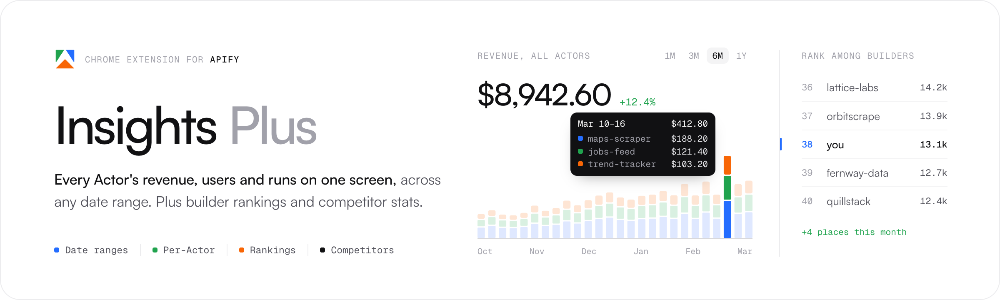
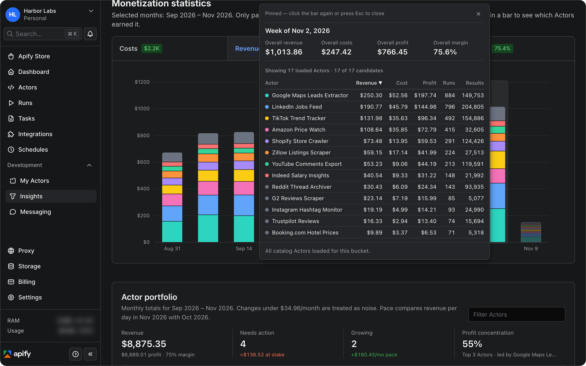
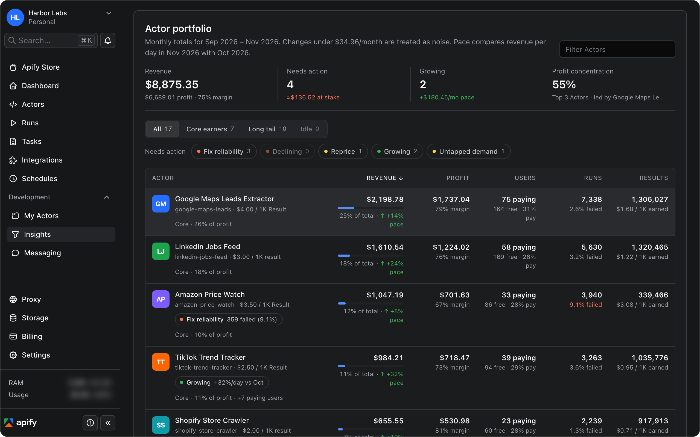
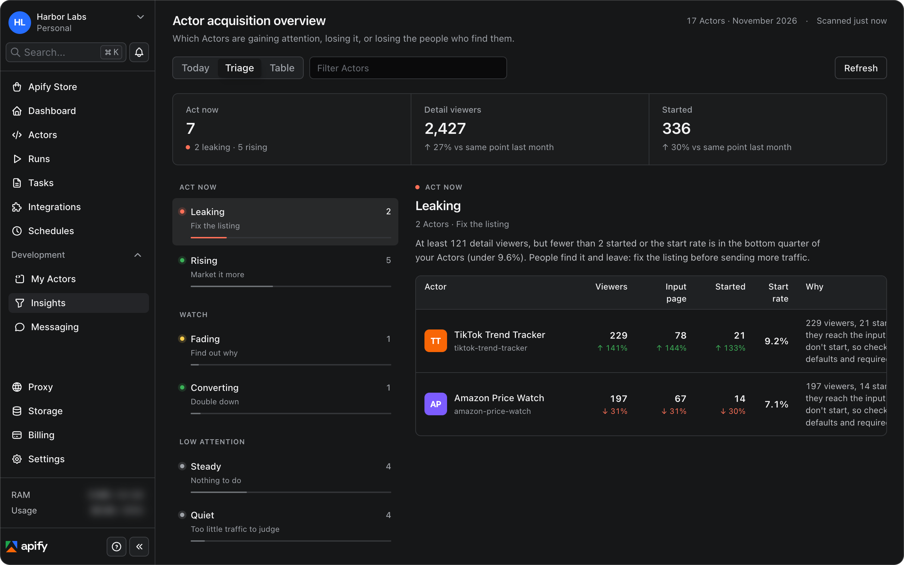
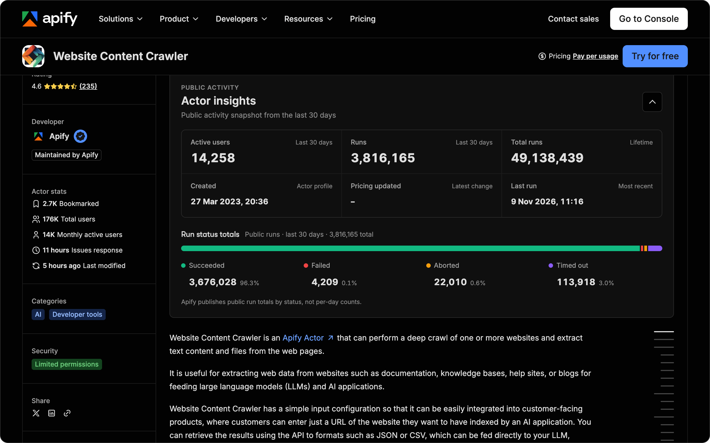
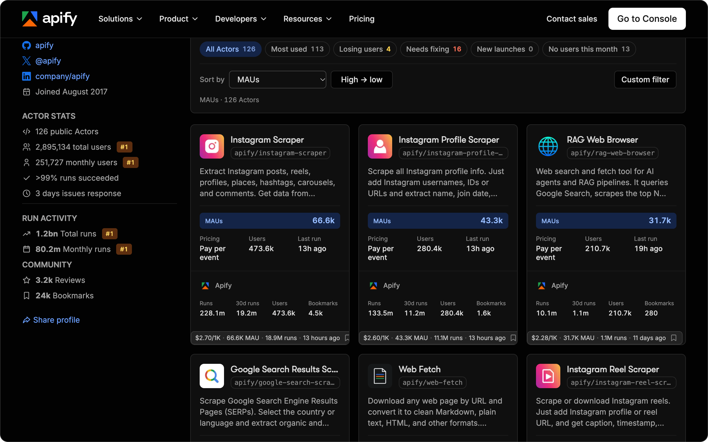
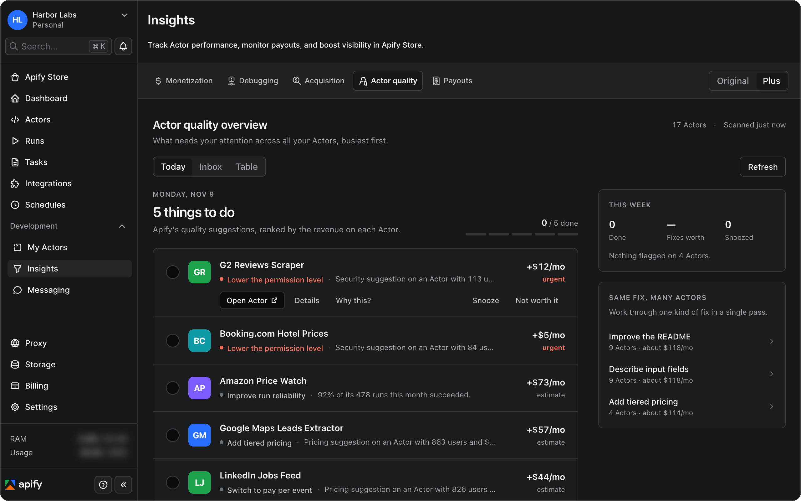
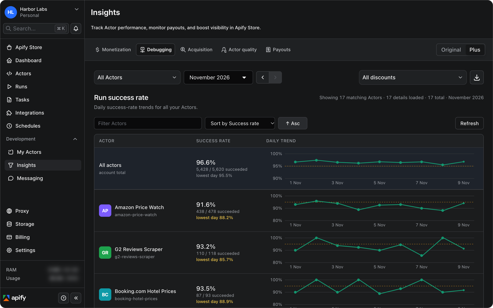
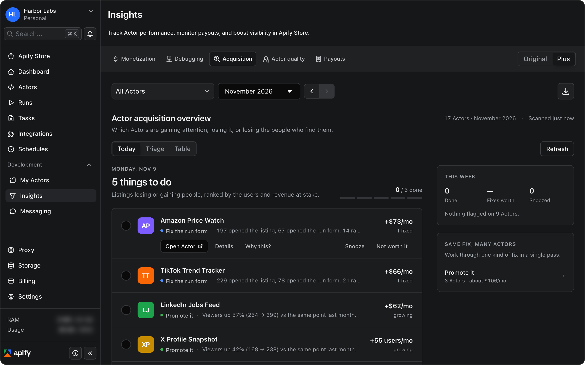

<p align="center">
  
</p>

<h3 align="center">See which of your Apify Actors earn, lose users or fail, without opening them one by one.</h3>

<p align="center">
  A Chrome extension that adds the missing views to Apify Console Insights:<br>
  any date range, every Actor in one table, and how you rank against other builders.<br>
  <sub>Apify's own views stay one click away.</sub>
</p>

<p align="center">
  <a href="https://chromewebstore.google.com/detail/insights-plus-for-apify/hompbapnjiphobkegjlcijoanjapmnhc"></a>
  
  
  
</p>

<p align="center">
  <a href="https://chromewebstore.google.com/detail/insights-plus-for-apify/hompbapnjiphobkegjlcijoanjapmnhc"><strong>Add to Chrome</strong></a> ·
  <a href="PRIVACY.md"><strong>Privacy</strong></a> ·
  <a href="CHANGELOG.md"><strong>Changelog</strong></a> ·
  <a href="https://github.com/Devansh-365/apify-insights-plus/issues/new/choose"><strong>Report a bug</strong></a>
</p>

## ✨ What you get

<sub>Console screenshots use a made-up demo account. Public pages show Apify's own profile and Actors.</sub>

<table>
  <tr>
    <td width="50%" valign="top">
      <br>
      <b>Revenue for any date range</b><br>
      <sub>Any months, grouped by day, week or month. Click a bar to see which Actors earned it, and export the range as JSON.</sub>
    </td>
    <td width="50%" valign="top">
      <br>
      <b>Every Actor ranked</b><br>
      <sub>Revenue, profit, paying users, failed runs and pace against last month, with Actors to fix, reprice or promote flagged.</sub>
    </td>
  </tr>
  <tr>
    <td width="50%" valign="top">
      <br>
      <b>Find the Actors losing users</b><br>
      <sub>Acquisition triage splits Actors into leaking, rising, fading and converting, with the viewers and start rate behind each call.</sub>
    </td>
    <td width="50%" valign="top">
      <br>
      <b>Check any Actor on Apify Store</b><br>
      <sub>Active users and runs for the last 30 days, total runs and how runs ended, on any Actor, yours or a competitor's.</sub>
    </td>
  </tr>
  <tr>
    <td width="50%" valign="top">
      <br>
      <b>See where any builder ranks</b><br>
      <sub>Sort anyone's Actors by monthly users, runs or bookmarks, pick out the ones losing users, and see their rank among all builders.</sub>
    </td>
    <td width="50%" valign="top">
      <br>
      <b>Quality fixes</b><br>
      <sub>Apify's quality suggestions for every Actor, ranked by the revenue on each one.</sub>
    </td>
  </tr>
  <tr>
    <td width="50%" valign="top">
      <br>
      <b>Run success</b><br>
      <sub>Every Actor's run success rate with a daily trend, lowest first.</sub>
    </td>
    <td width="50%" valign="top">
      <br>
      <b>Today</b><br>
      <sub>A short daily to-do list of listing fixes, ranked by the users and revenue at stake.</sub>
    </td>
  </tr>
</table>

Every Insights page has an **Original / Plus** switch, and every feature can be turned off in the popup.

## ⚡ Install

**Chrome Web Store:** [Add Insights Plus for Apify to Chrome](https://chromewebstore.google.com/detail/insights-plus-for-apify/hompbapnjiphobkegjlcijoanjapmnhc). Then open [Console Insights](https://console.apify.com/actors/insights/monetization) and choose **Plus**.

**From source:** clone the repo, open `chrome://extensions`, turn on **Developer mode**, click **Load unpacked** and pick the folder. Then open [Console Insights](https://console.apify.com/actors/insights/monetization) and choose **Plus**. Needs Chrome 111+.

## 💡 Good to know

- **Your token stays in the Console page.** A small page script makes a fixed list of read-only analytics requests with the session the Console already has. The rest of the extension never sees the token.
- **Nothing leaves your browser** except requests to Apify and one public benchmark file. No analytics, no servers of our own. Details in [PRIVACY.md](PRIVACY.md).
- **If Apify changes the Console**, a failing view falls back to Apify's original page. **Settings → Diagnostics → Save report** in the popup gives you a file to attach to a bug report.
- **Rankings** come from a daily snapshot of public profile data, built by [this script](scripts/refresh-builder-benchmark.js) on a daily GitLab CI schedule.

## 🛠️ Development

No dependencies, no build step. Plain JavaScript in `content/` and `lib/`.

```sh
# unit tests (Node 20+)
npm test

# test, build and verify the zip
npm run release:check
```

Code layout, release steps and the Console-change checklist are in [CONTRIBUTING.md](CONTRIBUTING.md). Security issues go through [SECURITY.md](SECURITY.md).

## 📄 License

[MIT](LICENSE), by Devansh Tiwari. Started as a fork of [apify-insights-plus](https://github.com/igolaizola/apify-insights-plus) by Iñigo Garcia Olaizola.

<sub>"Apify" is a trademark of Apify Technologies s.r.o. This project is independent and not affiliated with or endorsed by Apify.</sub>
